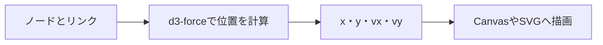

# d3-forceの基礎：力でノードの位置を計算する

[学習ガイド](./README.md) · 前：[force-graphの基礎](./force-graph.md)

対応するデモ：開発サーバーの`/learn/d3-force/`

## 1. d3-forceとは何か

d3-forceは、**ノードへ働く力を組み合わせ、位置と速度を少しずつ更新するJavaScriptライブラリ**です。点と線の座標を、反発力やリンクの力などから求めます。[公式ドキュメント](https://d3js.org/d3-force)

担当するのは位置の計算です。作品の内容、点同士を結ぶ理由、クリック後の処理などはアプリ側が決めます。d3-force自体にCanvasやSVGの描画を任せるわけでもありません。



本番のグラフビューではforce-graphが描画と操作を担当し、その内部でd3-forceを使います。今回のd3-forceデモは違いを見やすくするため、force-graphを使わず、計算した座標をJavaScriptでSVGへ反映しています。

## 2. ノードは位置と速度を持つ

| プロパティ | 意味 |
| --- | --- |
| `x`・`y` | 現在の位置 |
| `vx`・`vy` | X・Y方向の速度 |
| `fx`・`fy` | 指定した場合に固定する位置 |

初期位置がなければライブラリが用意します。シミュレーションは渡したノードを更新するので、原本を保持したい場合はコピーが必要です。[D3公式：ノード](https://d3js.org/d3-force/simulation#simulation_nodes)

デモのA〜Fボタンでノードを選ぶと、その点の`x`・`y`・`vx`・`vy`が表示されます。計算を停止すると、値がその時点で止まることも確認できます。

## 3. シミュレーションを作る

次は、2ノードを使って仕組みを示す最小例です。`render()`はアプリ側で用意する描画関数です。

```js
import { forceSimulation, forceManyBody } from 'd3-force';

const nodes = [
  { id: 'A', x: -30, y: 0 },
  { id: 'B', x: 30, y: 0 },
];

const simulation = forceSimulation(nodes)
  .force('charge', forceManyBody().strength(-100))
  .on('tick', () => render(nodes));
```

`forceSimulation()`は通常、自動で計算を始めます。デモの共通処理では最初に`stop()`して、UI側が再開や手動計算のタイミングを決めています。

## 4. 反発力：ノード同士を離す

`forceManyBody()`は、ノード間の反発・引力を表します。`strength()`が負なら反発、正なら引力として働きます。[D3公式：反発・引力](https://d3js.org/d3-force/many-body)

```js
simulation.force('charge', forceManyBody().strength(-100));
```

デモの「反発だけ」を選び、スライダーを変えて比較してください。UIでは分かりやすく正の大きさを表示し、内部では符号を反転して渡しています。

反発力だけでは、ノードを中心へ戻す力はありません。広がり続けて表示範囲から外れた場合は「全体を表示」で調整できます。「反発だけ」などのプリセットは、比較しやすいよう初期位置から計算をやり直します。

## 5. リンクの力：接続された点を目標距離へ近づける

`forceLink()`は、リンクの両端のノードを目標距離へ近づけます。離れすぎていれば近づけ、近すぎれば離す作用を持ちます。[D3公式：リンクの力](https://d3js.org/d3-force/link)

```js
import { forceLink } from 'd3-force';

simulation.force('link', forceLink(links)
  .id(node => node.id)
  .distance(90)
  .strength(0.4));
```

`id()`は、リンク内のIDからノードを探すための指定です。初期化後のリンクの`source`・`target`にはノード参照が入ることがあるため、元のID配列とは分けて管理します。

デモでは「反発＋リンク」を選んで、目標距離とリンクする力を変更できます。距離を90へ設定しても、すべての線が必ず長さ90になるとは限りません。ほかの力も同時に作用するためです。

リンクの力をオフにしても、デモの線は残ります。線は元の接続関係を表示し、チェックボックスはその接続を位置計算に使うかを切り替えています。

## 6. 中心力：各ノードを原点へ引く

本番では、各ノードを原点へ戻すために`forceX(0)`と`forceY(0)`を使っています。デモも同じ組み合わせです。[D3公式：位置の力](https://d3js.org/d3-force/position)

```js
import { forceX, forceY } from 'd3-force';

simulation
  .force('x', forceX(0).strength(0.05))
  .force('y', forceY(0).strength(0.05));
```

「中心力も追加」を選び、中心力の値を変えてみてください。デモの十字の交点が原点です。反発力やリンクの力とのつり合いによって、全体の広がりが変わります。

これはグラフ全体の重心を移す`forceCenter()`とは別の力です。force-graphには既定の`center`があるため、本番では`graph.d3Force('center', null)`で外してから、X・Y方向の力を追加しています。

## 7. tickとalpha：計算が進む仕組み

計算の一歩を**tick**と呼びます。大まかには、alphaを更新し、各力で速度を変え、速度を減衰させ、位置へ反映します。[D3公式：tick](https://d3js.org/d3-force/simulation#simulation_tick)

**alpha**は計算の活発さを調整する値です。通常は時間とともに減り、配置が落ち着く方向へ進みます。温度や冷却にたとえられますが、現実の物理現象を厳密に再現するための値ではありません。

```js
// 自動計算を停止
simulation.stop();

// 1回だけ計算し、描画は明示的に更新
simulation.tick();
render(nodes);

// 活発な状態に戻して、自動計算を再開
simulation.alpha(1).restart();
```

手動の`tick()`は`tick`イベントを発火しません。そのため「1 tickだけ進める」ボタンは、計算後に自分でSVGと数値を更新します。冷えきった状態の場合だけalphaを1に戻してから進めます。

デモの「力なし」で1 tick進め、初期速度が0なら位置が変わらないことを確認してください。次に反発力を使い、同じボタンで座標と速度の変化を観察できます。

`stop()`は計算の停止です。すでに描いた線や点を消す操作ではありません。また、値を変えただけで冷えた計算が十分に動くとは限らないので、デモは設定変更時にalphaを戻して再開します。

## 8. force-graphと組み合わせる場合

force-graph内部の計算へは、次のようにアクセスします。

```js
graph.d3Force('charge').strength(-100);
graph.d3Force('link').distance(90).strength(0.4);
graph.d3Force('center', null);
graph.d3Force('x', forceX(0).strength(0.05));
graph.d3Force('y', forceY(0).strength(0.05));
graph.d3ReheatSimulation();
```

ここでは、自分で`forceSimulation()`を追加して別の計算を走らせていません。force-graphが持つシミュレーションの力を調整しています。[force-graph公式：力の設定](https://github.com/vasturiano/force-graph#force-engine-d3-force-configuration)

本番の[graph-view.ts](../../src/scripts/graph-view.ts)の`applyForces()`では、固定の初期値から内部の強さを設定しています。本番の設定パネルはフィルタと画像ノードの切り替えで、力の調整はこの学習デモで試せます。デモは基本を比較するための値なので、本番と同じ配置になるとは限りません。

## 9. デモと本番の対応

| デモで学ぶこと | 本番の実装で必要なこと |
| --- | --- |
| 力の有効・無効とパラメーター | 初期値と`applyForces()`の接続 |
| 設定変更後の再開 | `d3ReheatSimulation()`による再計算 |
| 位置と速度の変化 | ノードの座標を使ったCanvas描画 |
| 原本のコピー | フィルタ用データと描画用データの分離 |
| 計算の停止 | 配置を止めてもズームや選択を残す制御 |
| 画面を離れる | シミュレーションや描画の停止・破棄 |

デモは[learn-d3-force.ts](../../src/scripts/learn-d3-force.ts)、計算の生成と設定は[d3-simulation.ts](../../src/lib/learn/d3-simulation.ts)を参照してください。SVGの属性更新もアプリ側のコードなので、「計算だけのライブラリ」であることを実装から確認できます。
